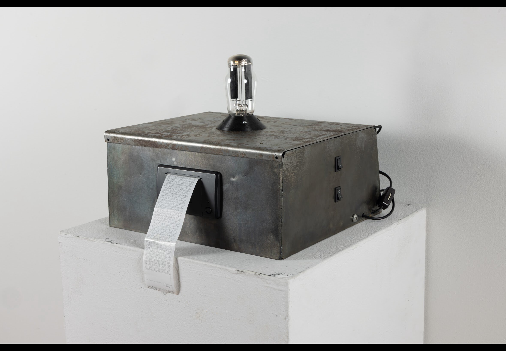

# Rectifier-Tube-White-Noise-Generator-and-RNG

I repurposed an old Sylvania 5U4G rectifier tube into a white noise generator. While contemplating the new and improved Plasma Entropy Source V.2 (coming soon) 
I was thinking about optimal sources of entropy for RNGs. Specifically , what is a spectacular source of white noise? What do I have at home sitting on my desk which I could turn into a RNG?
Then it struck me, why not repurpose an old rectifier tube! It's a simple mechanism , two plates for the current being rectified to enter and exit, and a filament, which undergoes thermionic emission. If I heat the filament, introduce a positive voltage field, then sample the fluctuating current (caused by shot noise) I should be able to harvest an ideal source of entropy.  
